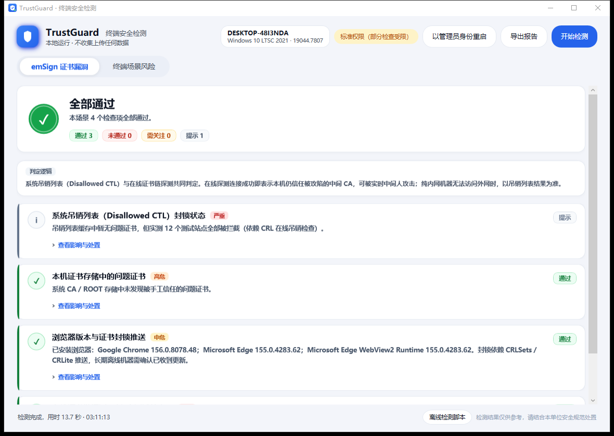
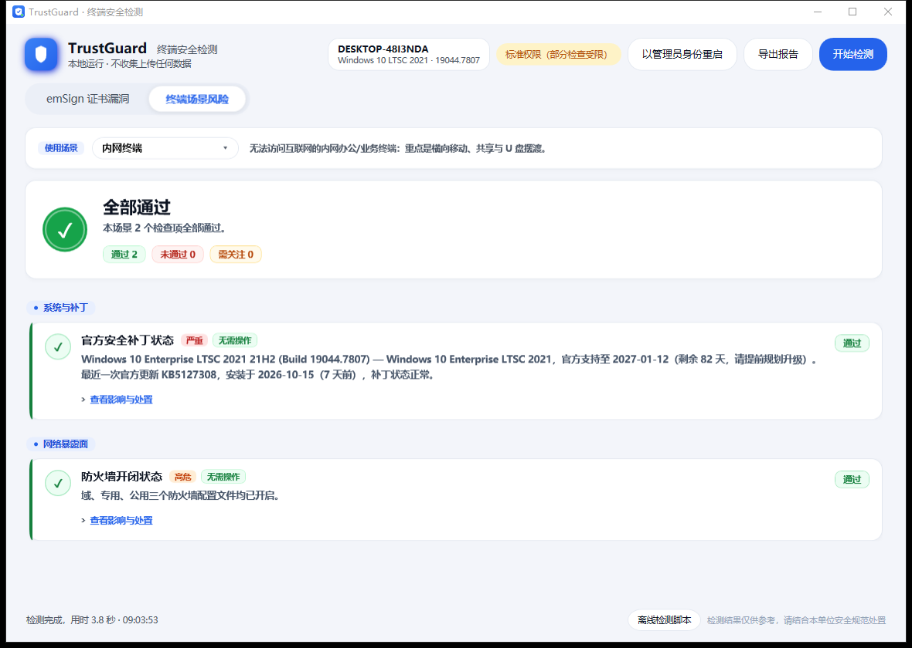
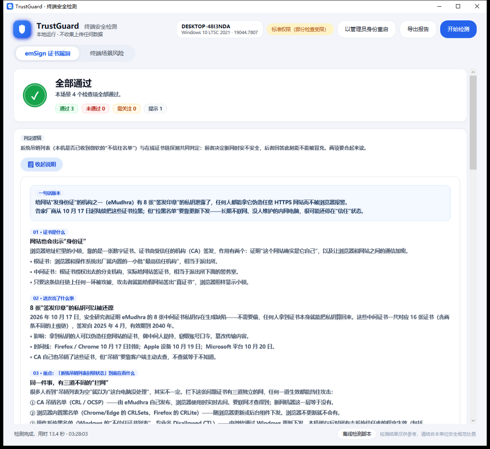

# emsign-trust-check

[](https://github.com/hybridsakura/emsign-trust-check/actions/workflows/ci.yml)
[](https://github.com/hybridsakura/emsign-trust-check/actions/workflows/release.yml)

A self-hostable, intranet-friendly checker for the **October 2026 eMudhra intermediate CA compromise** ("emSign certificate vulnerability"). It detects whether browsers on your network still trust the eight compromised eMudhra intermediate CAs (16 certificates including the Sectigo cross-signs).

Inspired by and data-sourced from [emudhra.we-have-a-problem.com](https://emudhra.we-have-a-problem.com/).

## Why self-host?

The compromised intermediates were blocked by Firefox/Chrome (Oct 17), Apple (Oct 19) and Microsoft (Oct 20) via revocation push mechanisms (CRLite, CRLSets, Disallowed CTL). **Long-offline intranet machines may never receive those pushes.** This tool is meant to be deployed inside your LAN so every machine can be checked from a central URL.

## What's inside

Two front ends share one purpose:

- **Web (Linux / Docker)** — a static page served by nginx; opens in any intranet browser.
- **Windows portable app (`TrustGuard.exe`)** — a self-contained WPF GUI (no installer, no .NET runtime needed) with green/red status lights and two tabs: emSign certificate checks and endpoint configuration risks.




| Path | Description |
|---|---|
| `windows/` | C# WPF source for `TrustGuard.exe` (see [Windows portable app](#windows-portable-app-trustguardexe)) |
| `scripts/` | Linux checker, air-gapped installer and offline bundle builder |
| `public/index.html` | English live-check page — probes 12 test hosts signed by the compromised intermediates. **Connected = still trusted = at risk.** |
| `public/zh.html` | 中文版检测页面（内容相同） |
| `public/downloads/Check-EmSignTrust.ps1` | Offline Windows checker: Disallowed CTL fingerprint comparison + browser inventory + optional live TLS probes. Works on machines with no Internet at all. |
| `public/downloads/fingerprints.json` | SHA-1/SHA-256 fingerprints of all 16 compromised certs (computed from PEM, SHA-256 verified against the official list). |
| `public/downloads/impacted-intermediates.json` | Official certificate data (with PEM) for offline chain verification with OpenSSL. |

## Run with Docker

```bash
docker build -t emsign-trust-check .
docker run -d --name emsign-trust-check -p 8080:80 --restart unless-stopped emsign-trust-check
```

or with Compose:

```bash
docker compose up -d
```

Then have every intranet machine open `http://<server>:8080/` in **each installed browser** and click **Run check**:

- ❌ **Connected** — the browser still trusts the compromised chain → at risk
- ✅ **Did not connect** — blocked by certificate validation → protected
- ⚠️ **Timed out** — inconclusive; if *all* rows time out, the machine has no external access → use the offline script instead

> The live check probes the public test domains run by the original disclosure site, so the *checking machine* (not the Docker host) needs to reach `*.we-have-a-problem.com`. For air-gapped machines, use `downloads/Check-EmSignTrust.ps1`.

## Deploying on an air-gapped network (no Internet at all)

The container is 100% static: it needs no registry, no CDN, no external asset at runtime. Everything is baked into the image, so an offline host only needs the exported tarball.

On a machine **with** Docker and Internet (the build host):

```bash
./scripts/build-offline-bundle.sh 1.0.0
```

This produces:

| Artifact | Use |
|---|---|
| `dist/emsign-trust-check-1.0.0-docker-amd64.tar.gz` | `docker load` on offline hosts — the entire image, no registry pull |
| `dist/emsign-trust-check-1.0.0-static.tar.gz` | plain web root + scripts for hosts **without** Docker |
| `dist/emsign-trust-check-1.0.0-windows-x64.zip` | portable `TrustGuard.exe` + offline scripts for Windows endpoints |
| `dist/SHA256SUMS` | integrity check before rollout |

On the offline host (copy `dist/` via USB or an internal share):

```bash
sha256sum -c SHA256SUMS

# Docker present:
tar xzf emsign-trust-check-1.0.0-static.tar.gz && cd emsign-trust-check-1.0.0
sudo ./scripts/install-offline.sh --docker --image ../dist/emsign-trust-check-1.0.0-docker-amd64.tar.gz

# No Docker (needs only python3, served via systemd):
sudo ./scripts/install-offline.sh --port 8080
```

Both modes verify themselves on `http://127.0.0.1:<port>/` using loopback only — no Internet required. To prove the container has no external dependency, you can run it with networking fully disabled:

```bash
docker run --rm --network none emsign-trust-check:1.0.0 sh -c 'wget -qO- http://127.0.0.1/ | head -3'
```

### Offline behaviour (verified, not assumed)

- The web UI has **zero external assets** — no CDN, no web fonts, no analytics. `scripts/check-offline-assets.sh` fails CI if any `<script src>`, `<link href>`, `@import` or `url()` points outside the site.
- On load, the page probes connectivity once. On an air-gapped host it immediately shows **“No Internet access detected”**, marks every row `not checked (offline)` and points to the bundled scripts. It deliberately **never reports “safe” from failed connections**, because a network failure and a rejected certificate look identical in the browser.
- `check-emsign-linux.sh` works with `--skip-online` (no network calls at all) and otherwise auto-skips the live probes after a 2-second egress check, so an isolated host doesn’t wait through 12 timeouts.
- CI runs the container with `--network none` and asserts that both pages and the downloads are served; `docker load` and the static `python3 -m http.server` path were also verified inside a network namespace.

## Windows portable app (`TrustGuard.exe`)

A single self-contained executable for Windows 10 (1607+) / Windows 11 x64 — no installer, no .NET runtime, no admin rights required to start. Built with C# + WPF (chosen over a web wrapper because managed endpoints are often air-gapped and may lack WebView2; .NET 8 self-contained removes every runtime dependency).

**Tab 1 — emSign certificate trust**
Disallowed CTL fingerprint match (16 certificates) · local CA/ROOT store scan · browser inventory · live TLS probes against the 12 test hosts.

A **plain-language explainer** is built into this tab (`📘 这个证书漏洞是怎么回事？`). It walks a non-specialist through what a certificate is, what actually leaked, why “Disallowed CTL” (the local untrusted list) is not the same thing as “am I currently exploitable”, how to read the four possible result combinations, and a remediation plan for networks **without WSUS or any central update push** — including an offline way to import the blocklist.



**Manual remediation without a patch pipeline.** `block-emsign-certs.ps1` writes the 16 certificates into the local *Disallowed* store, which is exactly what the Microsoft CTL update would do — no Internet, no WSUS, no root-certificate surgery, and reversible:

```powershell
powershell -ExecutionPolicy Bypass -File .\scripts\block-emsign-certs.ps1 -Status   # what is blocked now
powershell -ExecutionPolicy Bypass -File .\scripts\block-emsign-certs.ps1            # import (admin)
powershell -ExecutionPolicy Bypass -File .\scripts\block-emsign-certs.ps1 -Remove    # roll back
```

**Tab 2 — endpoint scenarios**
Two checks only, deliberately: **official security patch level** (OS support status, LTSC-aware, plus the install date of the most recent update) and **firewall state** (domain / private / public profiles). Every row carries a severity chip, an action chip (`待解决` / `无需操作`), a plain-language business impact and a remediation step. The machine-profile selector still tailors the guidance text shown above the list.

**Status lights**: green = pass, red = fail, amber = needs attention, grey = informational. An empty Disallowed CTL counts as informational when the live probes already prove the chains are blocked (CA-side CRL), instead of raising a false alarm.

**Elevation**: when started without admin rights the header shows *以管理员身份重启*; clicking it relaunches the same exe via UAC and closes the current instance. Elevation lets the firewall check read all profiles and gives the patch inventory full access.

**Reports & automation**:

```powershell
TrustGuard.exe                                                            # GUI
TrustGuard.exe --tab2                                                     # open on the scenarios tab
TrustGuard.exe --selftest --out C:\temp\report.json                       # headless, exit 1 if anything failed
```

GUI export writes a self-contained HTML report to the Desktop — the intended way to hand results to the security team.

Build (build machine only needs the .NET 8 SDK):

```powershell
powershell -ExecutionPolicy Bypass -File windows\build-win.ps1 -Version 1.0.0
# -> dist\emsign-trust-check-1.0.0-windows-x64.zip (~60 MB)
```

Each package contains `VERSION.txt` with the build version, timestamp and check count, so an old extracted folder can never be mistaken for a fresh build.

The exe is unsigned, so SmartScreen may warn on first launch ("More info → Run anyway"); sign it with your organisation's code-signing certificate for fleet rollout.

### Build variants

| Variant | Command | Contents |
|---|---|---|
| `Public` (default) | `./windows/build-win.ps1` | industry-neutral copy, safe to publish |
| `Internal` | `./windows/build-win.ps1 -Variant Internal` | adds organisation footer, signature and tech-support line sourced from `Branding/InternalBranding.local.cs` |

The internal branding file is **git-ignored** and never ships in this repository. `scripts/check-no-industry-terms.sh` (also run by CI) greps the tracked tree and fails if organisation- or industry-specific wording leaks into the public sources.

## CI/CD

| Workflow | Trigger | What it does |
|---|---|---|
| `ci.yml` | push to `main`, PR, manual | hygiene scan → Windows single-file build + headless self-test → Linux bundles → Docker image smoke test **with networking disabled** |
| `release.yml` | tag `v*` (or manual) | builds both packages, publishes a GitHub Release with `SHA256SUMS`, and pushes the image to `ghcr.io/hybridsakura/emsign-trust-check` |

Cut a release:

```bash
git tag v1.0.0
git push origin v1.0.0
```

Pull the published image:

```bash
docker run -d -p 8080:80 ghcr.io/hybridsakura/emsign-trust-check:latest
```

## Offline checking (Windows, no Internet)

```powershell
powershell -ExecutionPolicy Bypass -File Check-EmSignTrust.ps1 -SkipOnline
```

Three layers: Windows Disallowed CTL fingerprint match → browser version inventory → optional live TLS probes via `curl.exe` (Schannel). Verdicts: `PROTECTED` / `LIKELY-VULNERABLE` / `VULNERABLE`.

Batch collection across a domain (one CSV row per machine):

```powershell
powershell -ExecutionPolicy Bypass -File \\fileserver\share\Check-EmSignTrust.ps1 -SkipOnline -ExportCsv \\fileserver\share\results.csv
```

## Offline checking (Linux)

Download `downloads/impacted-intermediates.json`, then verify each chain against your local trust store with OpenSSL, or simply probe from the shell:

```bash
for h in dv-g3b ov-g3b ev-g3b dv-g3c ov-g3c ev-g3c; do
  for p in "" "-aaa"; do
    host="${h}${p}-emudhra.we-have-a-problem.com"
    if curl -s -o /dev/null --max-time 10 "https://$host/"; then
      echo "❌ $host — CONNECTED (still trusted!)"
    else
      echo "✅ $host — blocked (curl exit $?)"
    fi
  done
done
```

## Notes & caveats

- Layers can disagree; trust order: **live TLS probe > Disallowed CTL > version heuristics**.
- Firefox uses its own trust store + CRLite and is not covered by the Windows Disallowed CTL check — verify it with the live page.
- The 4 code-signing intermediates (EM OV CS CA - G3B/G3C) are included in the fingerprint comparison for forged-binary risk assessment.
- Remediation: latest OS cumulative updates and browser versions; dev toolchains NSS ≥ 3.131.1, certifi ≥ 2026.10.19, Node.js ≥ 22.23.4, Go ≥ 1.26.10, etc. Full list on the original site.

## Data sources

- Disclosure & test domains: https://emudhra.we-have-a-problem.com/
- Certificate list: https://emudhra.we-have-a-problem.com/impacted-intermediates.json (vendored in `public/downloads/`)
- Mozilla incident report: https://bugzilla.mozilla.org/show_bug.cgi?id=2083449

## License

MIT
